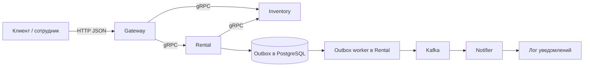

# Архитектура



Схема показывает запуск через Docker Compose с PostgreSQL и Kafka. Для локальной
разработки доступны хранилища в памяти и передача уведомлений по gRPC.

- **Gateway**: маршруты HTTP, преобразование JSON ↔ Protobuf, аутентификация,
  передача доверенной личности в сервисы, отображение ошибок. Своих данных нет.
- **Rental**: учётные записи, роли, сессии, корзины, заказы, история действий,
  фиксация стоимости, продолжение незавершённых операций и outbox.
- **Inventory**: каталог, физические экземпляры, техническое состояние,
  календарь, атомарное резервирование комплектов, выдача и возврат экземпляров.
- **Notifier**: очередь уведомлений, дедупликация по ID события, обработчик доставки.
  Реализован адаптер записи в лог. Реального Telegram/email пока нет.

В каждом бизнес-сервисе:

```text
cmd/app                  точка входа
internal/app             сборка зависимостей, жизненный цикл
internal/controller      входной транспорт и DTO
internal/usecase         сценарии и проверка прав
internal/entity          бизнес-сущности
internal/repository      PostgreSQL- и memory-хранилища
internal/adapter         исходящие вызовы
```

Интерфейсы объявлены рядом с потребителями. Entity не зависят от Protobuf.
Адаптер Inventory преобразует gRPC-ошибки в ошибки приложения.
`internal/platform` содержит технические средства: контекст пользователя,
межсервисную аутентификацию, запуск gRPC, преобразование ошибок.
Бизнес-модели между сервисами не импортируются.

Один Go-модуль используется для общей сборки и тестов. Каждый сервис
собирается в отдельный бинарник и контейнер.


## Согласованность между сервисами

Rental сначала сохраняет `pending`-заказ и его ID, затем вызывает Inventory.
Inventory использует ID заказа как ключ идемпотентности и сохраняет результат.
После успешного ответа Rental фиксирует состав, стоимость, историю и outbox-событие.
Rental не удерживает транзакцию БД во время сетевого запроса.

При сетевой ошибке заказ остаётся промежуточным. Обработчик раз в секунду
повторяет операцию с тем же ID. Это покрывает потерю ответа и временную
недоступность Inventory. В PostgreSQL-режиме незавершённые операции сохраняются
и продолжаются после перезапуска приложений. Аналогично продолжаются
`cancelling`, `issuing`, `returning`.

Основные состояния:

```text
pending -> confirmed -> active -> completed
   |           |
rejected    cancelled
```

Уведомление записывается атомарно с изменением заказа. Rental повторяет публикацию
события в Kafka. Notifier сохраняет событие, подтверждает offset и отдельно выполняет
доставку. Приём повторного ID не создаёт дубликат.
Для внешних адаптеров требуется учитывать повторную доставку после неоднозначного сбоя.


## Организация backend-кода

Структура backend:

```text
gateway/internal/
  adapter/adapter.go           Call со switch и общей функцией unary
  controller/httpapi/
    server.go                  общий HTTP-обработчик
    routes.go                  список маршрутов
    auth.go                    аутентификация и ограничения маршрутов
    http.go                    JSON-ответы и отображение ошибок

rental/internal/
  usecase/
    user/user.go               регистрация, сессии, роли
    cart/cart.go               чтение, проверка и изменение корзины
    order/
      order.go                 оформление и чтение заказов
      action.go                отмена, выдача и возврат
      operation.go             согласование состояния с Inventory
  worker/
    order/order.go             периодический повтор незавершённых операций
    notification/notification.go   передача событий из outbox
  controller/rental/           отдельные файлы user, cart, order, converter
  repository/postgres/        PostgreSQL-репозитории и SQL-миграции
  repository/rental/          memory-хранилище для разработки и тестов
  entity/                     сущности, константы ролей/состояний/действий
```

У каждого usecase собственные узкие интерфейсы зависимостей; пользовательский
usecase не зависит от Inventory или Notifier. Контроллер получает три usecase
отдельно. Сборка зависимостей находится в `internal/app`.

В PostgreSQL-режиме Rental изменяет заказ, очищает прежнюю версию корзины
и записывает outbox в одной транзакции. В memory-режиме эти данные находятся
в общем хранилище и изменяются под одним mutex.
Inventory также разделяет код каталога, доступности и резервов по файлам.

HTTP/gRPC-контракты, frontend и правила бронирования сохраняются при переключении
между реализациями хранилищ.

## PostgreSQL

У каждого бизнес-сервиса отдельная база и роль. Репозитории находятся в
`internal/repository/postgres`, SQL-миграции — в подпапке `migrations`.
Их автоматически применяет общий модуль `internal/postgres` при запуске.

- Inventory резервирует комплект в транзакции, блокирует модели в одинаковом порядке
  и использует GiST exclusion constraint для защиты от пересечения интервалов.
- Rental атомарно сохраняет заказ, событие outbox и условно очищает корзину, если её
  версия не изменилась. Версия заказа защищает от перезаписи устаревшим состоянием.
- Notifier сохраняет входящие события и состояние доставки. Приём повторного ID с тем
  же содержимым не создаёт новую запись; изменённое содержимое отклоняется.

Mutex usecase остаётся локальной координацией операций одного Rental. Корректность
резервов и атомарность изменений в PostgreSQL обеспечиваются самой БД.
Notifier пока рассчитан на одного обработчика; доставка имеет семантику at-least-once,
поэтому внешнему адаптеру нужно учитывать повтор при сбое между отправкой и отметкой.

Memory-реализации сохранены для разработки и тестов. В этом режиме потеря процесса
очищает данные; для согласованного демо перезапускайте весь стек.

Настройки и команды: [PostgreSQL](database.md).

В Compose события идут через Kafka; режим gRPC сохранён для локального запуска.
Подробнее: [Kafka](kafka.md).
